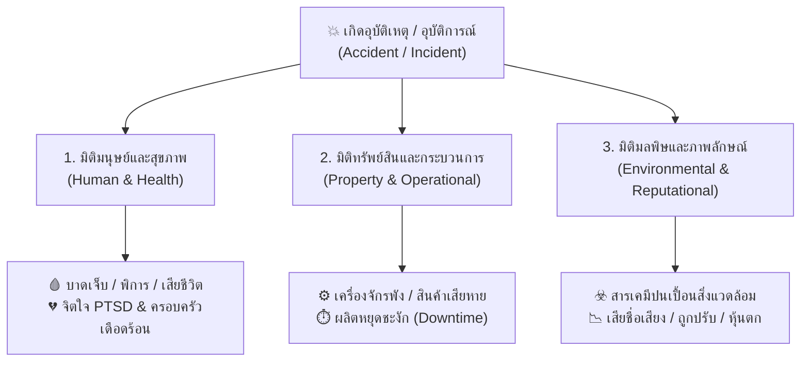

# Week 05: พื้นฐานการป้องกันอุบัติเหตุ (Basics of Accident Prevention)

---

## 📊 ส่วนที่ 3: ประเภทความสูญเสีย (Types of Losses in OHS)

> 💡 **บทนำ**  
> เมื่อเกิดอุบัติเหตุขึ้นในสถานที่ทำงาน คนทั่วไปมักมองเห็นเฉพาะ **"การบาดเจ็บของคน"** แต่ในทางอาชีวอนามัยและความปลอดภัย ความสูญเสียเปรียบเสมือน **"ระเบิดวงกว้าง"** ที่ไม่ได้กระทบแค่ร่างกายของผู้ประสบเหตุเท่านั้น แต่แผ่ขยายผลกระทบออกไปเป็น **3 มิติหลัก (3 Loss Dimensions)** ดังนี้:

---

### 🌐 ตาราง 3 มิติความสูญเสีย ถ่ายทอดผ่านกรณีศึกษาตัวละครทั่วโลก

| มิติความสูญเสีย (Loss Dimension)                                    | ขอบเขตผลกระทบ (Impact Scope)                                                                                                                                                                | ตัวอย่างเหตุการณ์และผลกระทบจริงจากตัวละครทั่วโลก (Global Character Examples)                                                                                                                                                                   |
| :------------------------------------------------------------------ | :------------------------------------------------------------------------------------------------------------------------------------------------------------------------------------------ | :--------------------------------------------------------------------------------------------------------------------------------------------------------------------------------------------------------------------------------------------- |
| **1. มิติการบาดเจ็บและสุขภาพ (Human & Health Loss)**             | • การบาดเจ็บเฉียบพลัน     (เจ็บเล็กน้อย/พิการ/เสียชีวิต) • โรคจากการทำงานสะสมเรื้อรัง • ผลกระทบทางจิตใจ     (PTSD/ภาวะซึมเศร้า) • ความเดือดร้อนของครอบครัวผู้ประสบเหตุ       | 🇲🇽 **คาร์ลอส (Carlos - เม็กซิโก):** ตกจากหลังคาสูง 6 เมตร กระดูกสันหลังและกระดูกเชิงกรานแตกหัก สูญเสียความสามารถในการเดิน (อัมพาตครึ่งท่อนถาวร) ไม่สามารถทำงานหาเลี้ยงลูกเมียได้ เกิดภาวะโศกเศร้าซึมเศร้ารุนแรงทั้งครอบครัว                  |
| **2. มิติทรัพย์สินและกระบวนการ (Property & Operational Loss)**   | • เครื่องจักร เครื่องมือ และอุปกรณ์ชำรุดเสียหาย • วัตถุดิบและชิ้นงานเสียหายถอนคืนไม่ได้ • สายการผลิตหยุดชะงัก    (Downtime) • ค่าใช้จ่ายซ่อมแซมและจัดหาเครื่องมือทดแทน          | 🇯🇵 **เคนจิ (Kenji - ญี่ปุ่น):** ขับฟอร์คลิฟต์ชนเสาอาคาร ทำให้อุปกรณ์งายกหัก ชิ้นส่วนเซมิคอนดักเตอร์มูลค่า 500,000 บาทตกกระจายเสียหายทั้งหมด สายประกอบรถยนต์ต้องหยุดผลิต (Downtime) 12 ชั่วโมง คิดเป็นมูลค่าสูญเสียโอกาสการผลิตกว่า 3 ล้านบาท |
| **3. มิติมลพิษและภาพลักษณ์ (Environmental & Reputational Loss)** | • สารเคมี/ก๊าซพิษรั่วไหลปนเปื้อน ดิน น้ำ อากาศ • ค่าปรับและโทษอาญาจากการฝ่าฝืนกฎหมาย • เสียชื่อเสียง แบรนด์ถูกแบน ลูกค้าcancelสัญญา • ราคาหุ้นตก และถูกเพิกถอนใบอนุญาตประกอบกิจการ | 🇨🇳 **หลี่เหว่ย (Li Wei - จีน):** คลังเคมีระเบิดทำให้สารตัวทำละลายไวไฟรั่วไหลลงสู่แม่น้ำสายหลัก ชุมชน 50,000 ครัวเรือนขาดน้ำประปา ปลานับแสนตัวตาย โรงงานถูกศาลสั่งปรับ 10 ล้านหยวน ถูกเพิกถอนใบอนุญาต และหุ้นบริษัทตก 40%                     |

---

### 🎨 สรุปแผนผังเชื่อมโยง 3 มิติความสูญเสีย (Mermaid Diagram)

---

> 💡 **บทสรุปสำคัญ:**  
> การป้องกันอุบัติเหตุจึงไม่ได้มีไว้เพื่อ *"ทำตามกฎหมายบังคับ"* เท่านั้น แต่คือการ **ปกป้องชีวิตมนุษย์ (Human Capital)** **คุ้มครองทรัพย์สินองค์กร (Asset Protection)** และ **รักษาความยั่งยืนของสิ่งแวดล้อมและชื่อเสียงธุรกิจ (Business Sustainability)** ในระยะยาว

## 📝 คำถาม / แบบทดสอบทบทวน ส่วนที่ 3

> 📌 **โจทย์และคำสั่งสำหรับนักศึกษา:**  
> จากเหตุการณ์จริงที่นักศึกษาได้เลือกวิเคราะห์ไว้ใน **ส่วนที่ 2 (แบบทดสอบทบทวน ส่วนที่ 2)** ให้นักศึกษาเขียน **เล่าเรื่องหรือสะท้อนความคิดเห็น (Reflection & Loss Analysis)** โดยตอบคำถามว่า:  
> **"นอกจากบาดแผล ร่างกายของผู้เจ็บป่วย หรือความเสียหายที่เห็นเด่นชัดด้วยตาเปล่า ณ หน้างาน (เช่น ไฟไหม้ เครื่องจักรพัง หรือการระเบิด) นักศึกษามองเห็น 'ความสูญเสียที่ซ่อนเร้น (Hidden Losses)' หรือผลกระทบอื่นๆ ในมิติใดอีกบ้างที่ตามมาหลังจากเหตุการณ์นั้นจบลง?"**

---

### 📋 แนวทางการเขียนตอบและประเด็นสะท้อนความคิดเห็น (Reflection Guidelines):

ให้นักศึกษาเขียนบรรยายความยาวประมาณ 10-15 บรรทัด โดยเจาะลึกความสูญเสียที่มากกว่าตาเห็น ในประเด็นดังต่อไปนี้:

1. 💔 **ผลกระทบทางจิตใจและสังคมซ่อนเร้น (Hidden Psychological & Social Losses):**
   * บาดแผลทางจิตใจ (PTSD, ภาวะซึมเศร้า, ฝันร้าย) ของผู้ประสบเหตุ เพื่อนร่วมงานที่เห็นเหตุการณ์ หรือครอบครัว
   * ภาระหนี้สิน ความเดือดร้อนของลูกเมีย/พ่อแม่ เมื่อหัวหน้าครอบครัวต้องสูญเสียรายได้หรือพิการ
2. ⏱️ **ความสูญเสียทางกระบวนการและโอกาสทางธุรกิจ (Hidden Operational & Opportunity Losses):**
   * เวลาที่ต้องสูญเสียไปกับการสอบสวนสวนคดี/การหยุดสายการผลิต (Downtime)
   * ค่าใช้จ่ายแฝง เช่น ค่าทำงานล่วงเวลา (OT) ของพนักงานคนอื่นเพื่อเร่งงานทดแทน, ค่าฝึกอบรมคนใหม่, เบี้ยประกันภัยที่ปรับตัวสูงขึ้น
   * การถูกยกเลิกสัญญาจ้างจากลูกค้า หรือการเสียโอกาสในการแข่งขันทางธุรกิจ
3. ☣️ **ความสูญเสียต่อชุมชน สิ่งแวดล้อม และภาพลักษณ์ (Hidden Environmental & Reputational Losses):**
   * มลพิษตกค้างในระยะยาวต่อสุขภาพของคนในชุมชนรอบข้าง (ฝุ่น พิษ ก๊าซ คราบสารเคมี)
   * ความบอบช้ำต่อชื่อเสียงขององค์กร ความเชื่อมั่นของสังคมและหุ้นส่วนที่ลดลง
........................................................................................................................................................................
   
   **คำตอบ**
   ชื่อ-นามสกุล : นราธิป สุขกิจ

รหัสนักศึกษา : 69030123

รายวิชา     : อาชีวอนามัยและความปลอดภัย (Occupational Health and Safety)

--------------------------------------------------

[ ข้อมูลสถานการณ์อุบัติเหตุจริงที่นำมาวิเคราะห์ ]

--------------------------------------------------

เหตุการณ์ช่างซ่อมบำรุงในโรงงานอุตสาหกรรม กำลังเร่งซ่อมเครื่องจักรในช่วงกะดึก 

สภาพพื้นที่หน้างานมีคราบน้ำมันเครื่องรั่วซึมเจิ่งนอง ช่างสวมถุงมือผ้าธรรมดา 

ไม่สวมรองเท้านิรภัยกันลื่น เดินเร่งรีบจนลื่นไถลหงายท้อง ร่างกายกระแทกเข้ากับ

โครงเหล็กเครื่องจักร ทำให้ข้อมือขวาและกระดูกซี่โครงแตกหัก ต้องหยุดงานรักษาตัวระยะยาว

==================================================

แบบทดสอบทบทวน ส่วนที่ 2 : ทฤษฎีการเกิดอุบัติเหตุและการย้อนเวลาแก้ไข

==================================================

[ 1. การวิเคราะห์ตามทฤษฎีโดมิโนของไฮน์ริช (Heinrich's Domino Theory) ]

1.1 การระบุตัวโดมิโนทั้ง 5 ตัว :

- โดมิโนตัวที่ 1 (ภูมิหลัง/สิ่งแวดล้อม) : วัฒนธรรมองค์กรที่กดดันให้เร่งผลิตและซ่อมแซมโดยละเลยความปลอดภัย

- โดมิโนตัวที่ 2 (ความบกพร่องของบุคคล) : ช่างมีความเหนื่อยล้าสะสมจากการทำงานกะดึก และมีนิสัยชอบทำงานลัดขั้นตอน

- โดมิโนตัวที่ 3 (สาเหตุทางตรง Unsafe Act / Condition) : ช่างไม่สวมใส่อุปกรณ์คุ้มครองความปลอดภัย (PPE) และปล่อยให้มีคราบน้ำมันรั่วซึมบนพื้นโดยไม่มีการเช็ดทำความสะอาด

- โดมิโนตัวที่ 4 (อุบัติเหตุ) : ช่างก้าวเดินด้วยความรีบร้อน เหยียบโดนคราบน้ำมัน ทำให้ลื่นไถลเสียหลักล้มกระแทกพื้น

- โดมิโนตัวที่ 5 (บาดเจ็บ/สูญเสีย) : ข้อมือและซี่โครงกระแทกกับโครงเหล็กจนหัก ต้องหยุดงานรักษาตัวระยะยาว

1.2 บทคำเตือนทะลุมิติย้อนเวลา (การดึงโดมิโนตัวที่ 3 ออก) :

"หยุดก่อนพี่! เช็ดคราบน้ำมันบนพื้นให้เรียบร้อยก่อน แล้วไปสวมรองเท้านิรภัยกับอุปกรณ์เซฟตี้ให้ครบ อย่าเพิ่งรีบเดินลุยสุ่มสี่สุ่มห้า!" 

(เป็นการตัดตอนไม่ให้เกิดการกระทำและสภาพที่ไม่ปลอดภัย ซึ่งช่วยหยุดยั้งไม่ให้เกิดอุบัติเหตุและการบาดเจ็บตามมา)

--------------------------------------------------

[ 2. การวิเคราะห์ตามทฤษฎีโดมิโนดัดแปลงของเบิร์ดและลอฟตัส (Bird & Loftus Domino Theory) ]

2.1 การวิเคราะห์ลำดับสาเหตุ 5 ขั้นตอน :

- ขั้นที่ 1 (Lack of Control - การขาดการควบคุม) : ฝ่ายบริหารไม่มีมาตรการตรวจสอบความปลอดภัยกะดึก และไม่มีระบบจัดการเรื่องคราบน้ำมันรั่วไหลที่ชัดเจน

- ขั้นที่ 2 (Basic Causes - สาเหตุพื้นฐาน) : พนักงานขาดการอบรมความปลอดภัยต่อเนื่อง (ปัจจัยคน) + เครื่องจักรเก่ามีรอยรั่วซึมสะสมและขาดการซ่อมบำรุงตามรอบ (ปัจจัยงาน)

- ขั้นที่ 3 (Immediate Causes - สาเหตุทางตรง) : พนักงานประมาทเร่งรีบทำงาน และมีสภาพพื้นที่ทำงานลื่นอันตราย

- ขั้นที่ 4 (Incident - อุบัติการณ์) : เกิดการลื่นล้มและร่างกายกระแทกเข้ากับวัตถุแข็งในพื้นที่ทำงาน

- ขั้นที่ 5 (Loss - ความสูญเสีย) : พนักงานบาดเจ็บกระดูกหัก และโรงงานต้องสูญเสียเวลาเดินเครื่อง (Downtime)

2.2 บทคำเตือนทะลุมิติย้อนเวลา (การปรับแก้ระบบตั้งแต่ต้นทาง) :

"ถึงฝ่ายบริหารและหัวหน้างานครับ ควรจัดให้มีระบบตรวจเช็กการรั่วซึมประจำกะ และเพิ่มงบอบรมความปลอดภัยให้พนักงาน เพื่อควบคุมความเสี่ยงและสร้างระบบที่ปลอดภัยตั้งแต่ต้นทาง!"

--------------------------------------------------

[ 3. การวิเคราะห์ตามโมเดลเนยแข็งสวิส (Reason's Swiss Cheese Model) ]

3.1 การวิเคราะห์รูรั่วแฝงบนแผ่นเนยป้องกันทั้ง 4 ด่าน :

- ด่านที่ 1 (นโยบาย/กฎระเบียบ) : [Latent Condition] นโยบายความปลอดภัยหย่อนยานในช่วงเร่งผลผลิตกะดึก

- ด่านที่ 2 (ระบบวิศวกรรม/เซฟตี้) : [Latent Condition] ไม่มีระบบเตือนจุดเสี่ยงน้ำมันรั่วซึม และไม่มีการติดตั้งแผ่นยางกันลื่นบริเวณทางเดิน

- ด่านที่ 3 (ขั้นตอน SOP/ป้ายเตือน) : [Active Failure] ไม่มีป้ายเตือน "ระวังพื้นลื่น" และช่างไม่ได้ตรวจสอบพื้นที่ก่อนปฏิบัติงาน

- ด่านที่ 4 (อุปกรณ์เซฟตี้ PPE) : [Active Failure] ช่างไม่ได้สวมรองเท้านิรภัยกันลื่นที่โรงงานจัดเตรียมไว้ให้

* จุดที่รูเนยตรงกัน (Alignment of Flaws) : 

นโยบายหละหลวม + ไม่มีแผ่นกันลื่น + ไม่ติดป้ายเตือน + ช่างไม่ใส่รองเท้าเซฟตี้ ทำให้รูรั่วของทุกด่านซ้อนทับกันพอดี ส่งผลให้เกิดอุบัติเหตุขึ้นจริงอย่างไร้การป้องกัน

3.2 บทคำเตือนทะลุมิติย้อนเวลา (การอุดรูรั่วไม่ให้รูเนยตรงกัน) :

"เฮ้ยน้อง! ถึงแม้บริษัทจะเร่งงานและนโยบายจะหลวม แต่อย่างน้อยด่านเราเองต้องไม่พลาด ไปใส่รองเท้าเซฟตี้แล้วเอาป้ายมาตั้งกั้นพื้นเปียกซะ เพื่ออุดรูรั่วในด่านของเราเอง ไม่ให้อันตรายทะลุด่านสุดท้ายเข้ามาทำร้ายเราได้!"

==================================================

แบบทดสอบทบทวน ส่วนที่ 3 : การวิเคราะห์ความสูญเสียที่ซ่อนเร้น

==================================================

[ การสะท้อนความคิดเห็นเกี่ยวกับความสูญเสียที่ซ่อนเร้น (Hidden Loss Reflection) ]

จากกรณีศึกษาอุบัติเหตุช่างซ่อมบำรุงลื่นคราบน้ำมันจนล้มกระแทกซี่โครงและข้อมือหักในกะดึก แม้ความสูญเสียทางกายภาพที่เห็นเด่นชัดจะเป็นการบาดเจ็บของช่างและความเสียหายของอุปกรณ์ แต่ในความเป็นจริงยังมี "ความสูญเสียที่ซ่อนเร้น (Hidden Losses)" แฝงอยู่อีกหลายมิติที่ตามมาดังนี้

1. ผลกระทบทางจิตใจและสังคมซ่อนเร้น :

- ด้านผู้ประสบเหตุและครอบครัว : การบาดเจ็บทำให้ช่างกังวลเรื่องรายได้ที่ลดลง ภาระหนี้สิน และเกิดความเครียดสะสมจากภาวะหวาดกลัวการทำงาน (PTSD) เมื่อต้องกลับมาทำงานกับเครื่องจักรอีกครั้ง

- ด้านเพื่อนร่วมงาน : เพื่อนร่วมกะที่เห็นเหตุการณ์เกิดความขวัญเสียและรู้สึกไม่มั่นคงปลอดภัยในการทำงาน

2. ความสูญเสียทางกระบวนการและโอกาสทางธุรกิจ :

- เวลาที่เสียไป (Downtime) : สายการผลิตต้องหยุดชะงักเพื่อปฐมพยาบาลและสอบสวนอุบัติเหตุ ทำให้สูญเสียโอกาสส่งมอบสินค้า

- ค่าใช้จ่ายแฝง : ต้องจ่ายค่าล่วงเวลา (OT) ให้พนักงานคนอื่นมารับงานแทน มีค่าใช้จ่ายในการฝึกอบรมคนใหม่ และเบี้ยประกันภัยโรงงานที่มีแนวโน้มถูกปรับสูงขึ้น

3. ความสูญเสียต่อภาพลักษณ์และความเชื่อมั่น :

- โรงงานเสียภาพลักษณ์ด้านมาตรฐานความปลอดภัย อาจถูกหน่วยงานภาครัฐเข้าตรวจสอบ และความเชื่อมั่นของผู้ว่าจ้างหรือลูกค้าลดลง

[ บทสรุป ]

อุบัติเหตุ 1 ครั้ง มีมูลค่าความสูญเสียแฝงอยู่ใต้ผิวน้ำมากกว่าค่ารักษาพยาบาลทางตรงหลายเท่าตัว การป้องกันอุบัติเหตุตั้งแต่ต้นจึงเป็นการคุ้มครองทั้งชีวิตพนักงานและเสถียรภาพขององค์กรในระยะยาว

